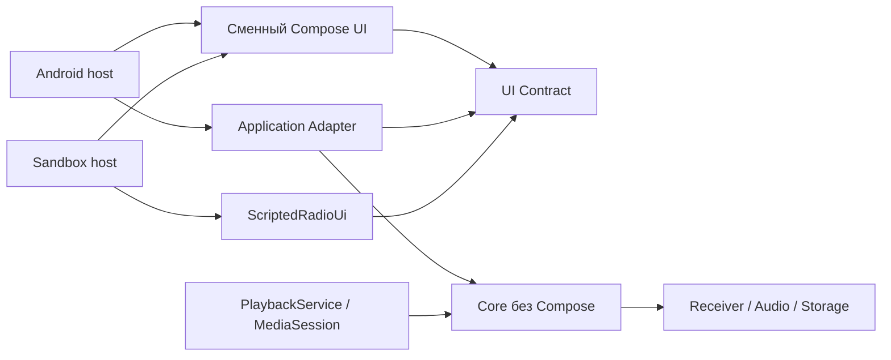

# UI Contract v1

Статус — утверждён владельцем 26.11.2026 по [ADR 0010](../adr/0010-ui-core-separation.md). Нормы поведения продукта задают [requirements.md](../requirements.md), [ADR 0003](../adr/0003-audio-focus-background-wheel.md), [ADR 0005](../adr/0005-autostart-last-station.md), [ADR 0007](../adr/0007-receivers.md) и [ADR 0008](../adr/0008-fm-only.md). Расхождения с текущим кодом описаны в [аудите](ui-core-audit.md). Сигнатуры ниже задают поведение для поэтапной реализации.

## Подключение UI

1. Реализуйте корневую функцию `@Composable fun RadioContent(radio: RadioUi, modifier: Modifier = Modifier)` в UI-библиотеке. Host вызывает её внутри `setContent`. Используйте `state.value` для первого кадра.
2. В Android собирайте `state` с учётом жизненного цикла. Передавайте снимок и callbacks экрану. Держите навигацию внутри Стоянки, текст формы, жесты и фокус виджета локально.
3. Отправляйте одно действие на один завершённый жест. Рисуйте подтверждённое состояние из снимка. Для синхронного отказа используйте `Admission.Rejected`, для результата принятого действия — состояние.
4. Для проверки подключите Sandbox вместо production host. Независимая сборка проходит с SDK контракта и UI исходниками. См. [набор для разработчика](#набор-для-разработчика-ui).



Стрелка означает зависимость кода. Контракт не импортирует Android и Compose. UI не импортирует Application, Activity конкретного приложения, Storage, USB, Receiver, Audio или Service. Host создаёт одну рабочую реализацию контракта на процесс. Sandbox создаёт свою реализацию на экземпляр сценария.

## State Contract

```kotlin
import kotlinx.coroutines.flow.StateFlow
import kotlin.time.TimeMark

interface RadioUi {
    val state: StateFlow<RadioUiState>
    suspend fun dispatch(action: RadioAction): Admission
}

data class RadioUiState(
    val mode: ScreenMode,                 // Efir, Parking
    val moving: Boolean,                 // R21
    val receiver: ReceiverView,
    val tuning: TuningView,
    val playback: PlaybackView,
    val stations: StationsView,
    val settings: SettingsView,
    val diagnostics: DiagnosticsView,
    val enabled: Set<Control>,
    val disabledReason: DisabledReason?,
    val actionIssue: ActionIssue?
)

data class ReceiverView(
    val selected: ReceiverId?,
    val availableProfiles: List<ReceiverOption>,
    val connection: Connection,
    val features: Set<Feature>
)
enum class Connection { Disconnected, DeviceFound, PermissionPending, Open, Observing }
enum class Feature { Seek } // подтверждённая Возможность первой версии проекта

data class TuningView(
    val confirmed: StationView?,
    val targetKhz: Int?,
    val saved: StationView?,
    val phase: TuningPhase,
    val pause: CommandPauseView?,
    val wheelSeekHintSeconds: Int?
)
enum class TuningPhase {
    Idle, Waiting, Unconfirmed, Unresponsive, Disconnected, CommandPause, Seeking, SeekIncomplete
}
data class CommandPauseView(
    val kind: PauseKind, val direction: Direction, val totalMillis: Long, val deadline: TimeMark
)
data class StationView(val frequencyKhz: Int, val name: String?)
data class PlaybackView(val status: PlaybackStatus, val focus: FocusEffect)
enum class PlaybackStatus { Stopped, Starting, Playing, Failed }
enum class FocusEffect { None, Normal, Ducking, Muted, PermanentLossContinuing, AutostartDenied }

data class StationsView(
    val loaded: Boolean,
    val regions: List<RegionView>,
    val activeRegionId: String?,
    val selections: List<SelectionView>,
    val activeSelectionName: String?,
    val catalog: List<CatalogStationView>,
    val catalogSource: CatalogSourceView?,
    val dataIssue: DataIssue?,
    val editIssue: EditIssue?,
    val catalogUpdate: CatalogUpdate
)
data class RegionView(val id: String, val name: String, val obsolete: Boolean)
data class SelectionView(val name: String, val entries: List<StationView>)
data class CatalogStationView(val id: String, val frequencyKhz: Int, val name: String)
data class CatalogSourceView(val name: String, val url: String)
data class SettingsView(
    val theme: ThemeChoice, val resolvedTheme: ResolvedTheme, val palette: Palette,
    val parkShowLabel: Boolean, val parkLargeIcon: Boolean, val scaleMarker: ScaleMarker,
    val autostart: Boolean, val seekLimitSeconds: Int?, val transitionSignal: SignalChoice?
)
data class DiagnosticsView(
    val buildVersion: String, val developerEnabled: Boolean,
    val export: ExportState, val detail: DeveloperDetail?
)
data class DeveloperDetail(
    val commands: Set<DiagnosticAction>, val frames: List<String>, val journalTail: String?,
    val audio: AudioMetrics, val environmentLines: List<String>, val rawByte7: Int?,
    val commandResult: DiagnosticResult?
)
```

`StateFlow` публикует последний согласованный снимок. Новый подписчик сразу получает текущее значение. Равные значения могут сливаться, промежуточные снимки могут пропускаться. Поля и вложенные коллекции представляют неизменяемые значения. Подписка не запускает действий. Для первого кадра доступны текущие настройки и версия, Эфир, связь Disconnected, без цели и подтверждения. До чтения данных `loaded=false`, звук Stopped, `focus=None`, детали отсутствуют. Набор доступных действий рассчитывает host. UI не обрабатывает поток как Журнал. [Документация StateFlow](https://kotlinlang.org/api/kotlinx.coroutines/kotlinx-coroutines-core/kotlinx.coroutines.flow/-state-flow/).

| Поле или случай | Источник и правило отображения |
| --- | --- |
| `confirmed` | Текущая подтверждённая FM-частота выбранного сеанса. Модуль подтверждает допустимым `0x22`. Отправка, сигнал звука и сохранение сами частоту не подтверждают. Если достоверной FM-частоты нет, значение `null`. У будущего RTL-SDR V4 подтверждение наступает после успешной настройки по R06. |
| `targetKhz` | Последняя принятая цель Перехода. Может появиться до отправки. UI показывает контур, пока цель есть. Бегунок подтверждения меняется только по `confirmed`. Шаг и Поиск могут идти без известной цели. |
| `saved` | Последняя сохранённая FM-частота. При отсутствии подтверждения можно показать приглушённое значение и бледную отметку на шкале, как в текущем UI. Семантика отметки называет её сохранённой. Подтверждённая отметка требует `confirmed`. Сохранённая частота не даёт права «Сохранить текущую частоту». Если актуальный внутренний ответ показывает AM, верхняя строка оставляет частоту пустой по текущему поведению. Adapter выражает это для UI отсутствием допустимого резерва в этом снимке. |
| Имя Станции | Для отображаемой частоты берётся непустое имя из Активной Подборки, затем первой совпавшей по частоте записи Справочника выбранного Региона. Если имени нет, UI использует «Частота вне Подборки». Собственные имена записей Подборки сохраняются. |
| Связь | До discovery или после отказа/отключения допустим `Disconnected`. `PermissionPending` и `Open` не означают допуск команд. `Observing` разрешает попытку действия с учётом состояния и Возможностей. Нет ответа Приёмника и detach различаются. |
| Звук и фокус | `Starting` и `Playing` означают состояние тракта, а не гарантию слышимости. Постоянный LOSS сохраняет живой звук. DUCK даёт 30 %, TRANSIENT приглушает при работающем потоке, GAIN возвращает уровень. Ручной запуск при отказе фокуса сохраняет текущую политику. `AutostartDenied` показывает отказ автостарта, не мешает ручному Старту. Публикация эффекта требует проекции из существующего владельца фокуса, который сегодня хранит и журналирует политику. |
| Станции и Регион | Получать уже отсортированные Регионы, включая Устаревшие. Подборки относятся к активному Региону. Активная Подборка может быть пустой. `loaded=false` показывает загрузку либо ошибку чтения. Идентификатор Региона стабилен. Имя Подборки служит ключом внутри Региона и меняется при rename. Частота служит ключом в Подборке. ID Станции служит ключом в Справочнике, где две записи могут иметь одну частоту. |
| Настройки | ThemeChoice: Auto/Dark/Light, ResolvedTheme: Dark/Light. Без сигнала ГУ для Auto — Dark. Palette: Coral/Amber/Plum/Lime. ScaleMarker: Pin/Flag/Needle/Drop/Stripe. SignalChoice: Off/Tone/KeyClick/Silence. При отсутствии настройки у выбранного Приёмника её значение `null` и элемент скрыт. |
| Диагностика | Версия сборки и признак Режима разработчика доступны без технических данных. На стоянке доступны состояние экспорта и результат с путём и байтами. `detail` появляется после запроса обновления, пока разрешены инструменты. Кадры и хвост Журнала — подготавливаемый текст до 100 строк кадров и 32 КиБ Журнала. Серийники, имя ГУ и имя пользователя в интерфейс не попадают. Диагностика может показать `rawByte7` с названием «Байт +7» без шкалы и единицы измерения. |
| Пауза команды | `deadline` — отметка времени из монотонных часов текущего процесса. Остаток равен `(-deadline.elapsedNow()).inWholeMilliseconds.coerceIn(0L, totalMillis)`. Adapter переводит срок из часов Приёмника на момент публикации. Sandbox использует управляемые часы. UI рисует остаток локально и ждёт нового допуска от host. Пересоздание экрана не сбрасывает отсчёт. |
| Доступность | `enabled` — подсказка к видимости и активности. Worker заново проверяет допуск. UI применяет R21 для расположения, размера, контраста и Причины выключения. Отключённые и скрытые элементы не принимают taps. |

Правила `DisabledReason` следуют R21: `Unresponsive`, `Disconnected`, `PermissionPending`, `Connecting`, `Unconfirmed`, `EmptySelection`, в указанном порядке. Состояние `AutostartDenied` на живой связи имеет отдельное сообщение R25. Пустая Подборка блокирует только переход по Подборке. При активном или незавершённом Поиске статус Поиска имеет приоритет над пустой Подборкой. Пауза команды не становится общей Причиной выключения.

| Текущий или будущий Приёмник | Seek | Отмена | Уровень сигнала / SNR / RDS |
| --- | --- | --- | --- |
| Модуль на базе аудита | Да | Нет | Полей нет. Байт `+7` относится только к Диагностике. |
| RTL-SDR V4, план первого релиза | Нет | Нет | Полей нет. Порог SNR для будущего Поиска требует измерений. Декодер RDS и показ сигнала требуют отдельных задач и приёмки. |
| Sandbox | Имитация обоих случаев | Нет | Проверяет скрытие неподдержанных элементов. |

Стерео, lock, спектр и полоса RDS не публикуют данных в v1. Разметка сохраняет требования R17/R18/R21. Имитация профиля без Поиска не удостоверяет работу RTL-SDR V4.

## Action Contract

```kotlin
sealed interface Admission {
    data object Accepted : Admission
    data class Rejected(val reason: RejectReason) : Admission
}
sealed interface RadioAction {
    data class TuneFrequency(val frequencyKhz: Int) : RadioAction
    data class SelectStation(val regionId: String, val ref: StationRef) : RadioAction
    data class MoveInSelection(val direction: Direction) : RadioAction
    data class Step(val direction: Direction) : RadioAction
    data class Seek(val direction: Direction) : RadioAction
    data object Start : RadioAction
    data object Stop : RadioAction
    data object CheckConnection : RadioAction
    data object RetryPermission : RadioAction
    data object EnterParking : RadioAction
    data object ExitParking : RadioAction
    data class ActivateSelection(val regionId: String, val name: String) : RadioAction
    data class SelectRegion(val id: String) : RadioAction
    data class DeleteObsoleteRegion(val id: String) : RadioAction
    data class Edit(val change: SelectionEdit) : RadioAction
    data object UpdateCatalog : RadioAction
    data class ChangeSetting(val change: SettingChange) : RadioAction
    data class SetDeveloper(val enabled: Boolean) : RadioAction
    data object RefreshDiagnostics : RadioAction
    data object ExportJournal : RadioAction
    data class RunDiagnostic(val command: DiagnosticAction) : RadioAction
}
```

Следующие типы дополняют сигнатуры. Списки ключей задают закрытый набор первой версии.

```kotlin
enum class ScreenMode { Efir, Parking }
enum class Direction { Up, Down }
enum class PauseKind { Step, Seek }
enum class DisabledReason { Unresponsive, Disconnected, PermissionPending, Connecting, Unconfirmed, EmptySelection }
enum class Control {
    TuneFrequency, SelectStation, MoveInSelection, Step, Seek, Start, Stop, CheckConnection,
    RetryPermission, EnterParking, ExitParking, ActivateSelection, SelectRegion,
    DeleteObsoleteRegion, Edit, UpdateCatalog, ChangeSetting, SetDeveloper,
    RefreshDiagnostics, ExportJournal, RunDiagnostic
}
enum class RejectReason {
    WrongMode, NotForeground, NotConnected, Unsupported, Busy, RateLimited,
    InvalidInput, StaleContext, IncompatibleState, TransportError
}
data class ActionIssue(val control: Control, val reason: RejectReason)

@JvmInline value class ReceiverId(val value: String)
data class ReceiverOption(val id: ReceiverId, val displayName: String)

sealed interface StationRef {
    data class Catalog(val stationId: String) : StationRef
    data class Selection(val selectionName: String, val frequencyKhz: Int) : StationRef
}
data class SelectionRef(val regionId: String, val name: String)
sealed interface SelectionEdit {
    data class Create(val selection: SelectionRef) : SelectionEdit
    data class Rename(val selection: SelectionRef, val newName: String) : SelectionEdit
    data class Delete(val selection: SelectionRef) : SelectionEdit
    data class Add(val selection: SelectionRef, val station: StationView,
                   val catalogId: String? = null) : SelectionEdit
    data class EditName(val selection: SelectionRef, val frequencyKhz: Int, val newName: String) : SelectionEdit
    data class Remove(val selection: SelectionRef, val frequencyKhz: Int) : SelectionEdit
    data class Move(val selection: SelectionRef, val frequencyKhz: Int, val toIndex: Int) : SelectionEdit
    data object ClearIssue : SelectionEdit
}

enum class ThemeChoice { Auto, Dark, Light }
enum class ResolvedTheme { Dark, Light }
enum class Palette { Coral, Amber, Plum, Lime }
enum class ScaleMarker { Pin, Flag, Needle, Drop, Stripe }
enum class SignalChoice { Off, Tone, KeyClick, Silence }
sealed interface SettingChange {
    data class Theme(val value: ThemeChoice) : SettingChange
    data class PaletteChoice(val value: Palette) : SettingChange
    data class ParkLabel(val show: Boolean) : SettingChange
    data class ParkIcon(val large: Boolean) : SettingChange
    data class Marker(val value: ScaleMarker) : SettingChange
    data class Autostart(val enabled: Boolean) : SettingChange
    data class SeekLimit(val seconds: Int) : SettingChange
    data class TransitionSignal(val value: SignalChoice) : SettingChange
    data class Receiver(val id: ReceiverId) : SettingChange
}

enum class DataIssue { LoadFailed, Recovered, SaveFailed }
enum class EditIssue { InvalidName, DuplicateName, InvalidFrequency, DuplicateFrequency, LastSelection, NotFound }
sealed interface CatalogUpdate {
    data object Idle : CatalogUpdate
    data object InProgress : CatalogUpdate
    data object NoUpdate : CatalogUpdate
    data class Updated(val revision: String) : CatalogUpdate
    data object Failed : CatalogUpdate
}
sealed interface ExportState {
    data object Idle : ExportState
    data object InProgress : ExportState
    data class Exported(val path: String, val sizeBytes: Long) : ExportState
    data object Failed : ExportState
}
enum class DiagnosticAction {
    CheckLink, StepFrequencyUp, StepFrequencyDown, ReturnToFm, ReselectCurrent,
    SeekFrequencyUp, SeekFrequencyDown
}
enum class DiagnosticOutcome { Sent, InvalidFrequency, NotConnected, IncompatibleState, RateLimited, TransportError }
data class DiagnosticResult(val action: DiagnosticAction, val outcome: DiagnosticOutcome)
data class AudioMetrics(
    val bytes: Long?, val badPackets: Long?, val realignments: Int?, val underruns: Int?,
    val maxReadGapMillis: Long?, val longPauses: Int?, val minBufferedFrames: Long?,
    val lostLogRecords: Long?, val logWriteFailures: Long?
)
```

`ReceiverId` — непрозрачный стабильный ID профиля. Профиль в списке означает зарегистрированный вид. UI показывает список выбора только при двух и более профилях. `Control` задаёт ключи действий в таблице. UI использует их для представления, а Adapter проверяет аргументы и условия вызова. `ActionIssue` сообщает последний актуальный отказ после постановки в очередь. Он связан с семейством операции и текущим контекстом, включая активную цель, когда она существует. Новый запрос этого семейства, смена профиля или выход из контекста снимают прошлый отказ. UI локализует причины и сохраняет несохранённый ввод.

| Control и действие | Допуск и эффект |
| --- | --- |
| SelectStation / TuneFrequency | Эфир, подключённый Приёмник и допустимая FM-частота. SelectStation сверяет Регион, источник и запись. В Подборке проверяет, что выбранная запись остаётся в указанной Подборке. TuneFrequency использует тот же путь Перехода и ручного Старта. Диапазон 87 500–108 000 кГц с шагом 100 кГц. При известном AM Core возвращается на FM. При неизвестном диапазоне Модуль отклоняет Переход как IncompatibleState. UI форматирует МГц. Самостоятельное поле прямого ввода в Эфире не входит в эту миграцию. |
| MoveInSelection | Эфир и непустая Активная Подборка. Курсор двигается сразу, первая команда после паузы уходит сразу. Руль следует R24 через отдельную точку входа host. |
| Step / Seek | Эфир. Шаг и Поиск требуют известного FM в текущем сеансе. При AM или до первого наблюдения worker отклоняет их как IncompatibleState. Для экранного Seek автомобиль стоит и есть Возможность. Долгое нажатие руля разрешено на ходу по R24. UI не подставляет источник «руль». |
| Start / Stop | Явные намерения. Повтор того же действия не создаёт новый сервис или новый цикл остановки. Start использует текущий путь ручного запуска и reclaim. Stop записывает `lastPlayed=false`. Подтверждение настройки не выводится из статуса аудио. |
| CheckConnection / RetryPermission | Проверка связи при живом USB в состоянии Unconfirmed либо повтор запроса после отключения/отказа. Permission dialog принадлежит Android host. Автоматический запрос из подписки UI запрещён. |
| EnterParking / ExitParking | Войти можно в foreground, пока сигнал движения ложен. Выход закрывает этот допуск. Host сбрасывает допуск в начале движения и при уходе Activity в фон. |
| ActivateSelection | Эфир или Стоянка. Проверить Регион и имя. Замена Активной Подборки не отправляет настройку. |
| SelectRegion / DeleteObsoleteRegion / Edit | Стоянка. Удаление Устаревшего Региона подтверждает пользователь. `Edit` поддерживает Create/Rename/Delete Подборки с Region ID и именем, Add/EditName/Remove/Move Станции с Region ID и именем Подборки. Ключ Станции — частота, Move дополнительно получает индекс в том же порядке, с нуля. Add получает имя, частоту и исходный ID при копировании Станции из Справочника. EditName сохраняет частоту. ClearIssue очищает ошибки формы. |
| UpdateCatalog | Стоянка, одно ручное обновление по HTTPS. Загрузка включает индекс и файлы Регионов по ADR 0009. Нет фонового старта, импорта ZIP или возврата к снимку APK через этот контракт. |
| ChangeSetting | Стоянка. Закрытые варианты Theme/PaletteChoice/ParkLabel/ParkIcon/Marker/Autostart/SeekLimit/TransitionSignal/Receiver. Предел 10–60 с с шагом 5, по умолчанию 20. Сигнал и Предел доступны у Модуля. Смена Приёмника останавливает прежний поток и повторно проверяет допуск перед применением. |
| SetDeveloper / RefreshDiagnostics / ExportJournal | Стоянка. Для деталей и RefreshDiagnostics дополнительно нужен Режим разработчика. Один экспорт и одно чтение за раз. Экспорт Журнала не останавливает звук. |
| RunDiagnostic | Стоянка и включённый Режим разработчика. Разрешённый набор объявляет Adapter для выбранного профиля. Таблица ниже связывает действия со штатными кнопками. Payload, произвольный hex и идентификатор устройства отсутствуют. Guard и лимиты проверяет владелец операции. |

| Диагностическое действие | Существующая кнопка и смысл |
| --- | --- |
| CheckLink | requestAllInfo. По нажатию, с лимитом связи. |
| StepFrequencyUp / StepFrequencyDown | TUNEDOWN / TUNEUP. Имена действий описывают изменение частоты, а названия команд сохраняются по каталогу. |
| SeekFrequencyUp / SeekFrequencyDown | SEEKDOWN / SEEKUP. Учитывать доступность Поиска и лимит. |
| ReturnToFm | BAND только при известном AM. Уже FM или диапазон неизвестен — действие недоступно. Worker в этих состояниях отправляет ноль TX. |
| ReselectCurrent | playSelect текущей подтверждённой FM-частоты. Без актуального FM-подтверждения действия нет. |

Правила направления и отправки задаёт [каталог команд](../research/command-catalog.md). Ограничение ReturnToFm устраняет расхождение текущей диагностической кнопки с whitelist, отмеченное в аудите.

Имена Станций после trim имеют 1–32 символа, частота уникальна в Подборке, последняя Подборка не удаляется. Хранимые старые записи без имени читаются. `DiagnosticResult` описывает результат отправки. Sent не означает подтверждение Приёмника.

`AudioMetrics` содержит существующие счётчики байтов, плохих пакетов, выравниваний, underrun, максимальной паузы чтения в мс, числа пауз свыше 100 мс, минимального запаса кадров, потерянных записей Журнала и ошибок записи. Значение неизвестного измерения отсутствует. UI не вычисляет из него уровень сигнала.

## Behavior Contract

1. `dispatch` быстро возвращает допуск, без ожидания USB, звука, диска и сети. Перед постановкой проверяет тип, режим, профиль и доступный контекст. Accepted означает «взято в обработку». Accepted не означает отправку либо успех. Worker проверяет допуск перед эффектом. Поздний Busy, RateLimited, IncompatibleState или TransportError публикуется в `actionIssue`, если контекст ещё актуален. Ошибки записи, сети и экспорта публикуются в своих полях. Ошибка транспорта одновременно может изменить связь. Если контекст сменился, worker отбрасывает работу без записи, TX или ошибки на новом экране.
2. Один владелец публикует снимок после последовательного применения результатов. Команда и reply обрабатываются по порядку очереди Приёмника. Агент UI не считает каждое изменение отдельным событием. Ошибки формы и операции относятся к текущему контексту; смена Региона, Подборки или формы снимает устаревшую ошибку.
3. Переход хранит только последнюю цель. У Модуля минимум 1 с между playSelect. Для возврата из AM применяются внутренний BAND и единый срок R26. Отправленный BAND отменить нельзя. До порога 300 мс нет надписи «ожидание». Через 3 с без подтверждения — Unconfirmed. Связь восстанавливается по R26. «Проверить связь» не чаще 1 раза в 10 с, без автоповтора после ошибки. При восстановлении обработать только разрешённый R25/R26 сценарий.
4. Шаг ждёт подтверждение, пауза минимум 500 мс. Ранние повторы отбрасываются. Поиск запускается не чаще 1 раза в 5 с и после предыдущего. Контроллер читает Предел в момент отправки. Нормальное завершение — пауза 300 мс после последнего кадра серии `0x22` до Предела. Контроллер проверяет истечение Предела первым. Истечение даёт SeekIncomplete без TX; у Модуля отсутствует доказанный отдельный исход «станция не найдена». Поздний валидный кадр того же сеанса может обновить фактическую FM-частоту без отмены SeekIncomplete. Начало движения не отменяет уже начатый Поиск.
5. Внутреннее поколение меняется при detach, смене и новом сеансе. После смены поколения старые события не обновляют новый снимок. Очистить цель, подтверждение, паузу и детали Приёмника. Новый Observing ещё не подтверждает частоту. Adapter ждёт новое наблюдение этого поколения. Хранимая частота остаётся отдельной. На другой Приёмник автоматически не переходить. Для валидного ответа текущего сеанса обновить подтверждённое наблюдение, даже если оно отличается от цели. Снять ожидание Перехода только по совпавшему подтверждению после отправки либо соответствующему исходу R26. Совпадение до отправки может обновить наблюдение, но не завершает ожидающий Переход.
6. Host управляет разрешениями, GNSS и R25. Подписка/рекомпозиция, смена экрана и отмена корутины подписчика не закрывают Приёмник и не запускают автостарт. Работа, принятая в очередь, принадлежит владельцу операции. Выход из Стоянки, движение и `onStop` отменяют обновление Справочника по R13/R23. Уже начатый экспорт завершает запись в фоне. Host скрывает результат до возврата на Стоянку.
7. Хост применяет R21 к определению движения. Guard для стоянки действует по foreground, режиму и движению. Он проверяет поколение допуска при записи, выборе Приёмника и ТХ. Это предотвращает запоздалое действие после нового входа. Уже отправленная команда остаётся у Приёмника. Политика «нет GNSS — стоит» сохраняется по R21.
8. Экран может запрашивать диагностику только в открытом разделе Инструментов, не чаще раза в секунду. Отрисовка и сбор состояния сами не читают Журнал. Потеря допуска очищает детали, а завершённое чтение старого сеанса игнорируется. Аудиопоток не собирает снимки и не ждёт UI.
9. MediaSession и руль обращаются к правилам приложения из Service. Короткое действие, длинное действие и reclaim сохраняют R24. Закрытие Service освобождает сессию и таймеры руля. Замена composable не меняет notification destination, Android permissions и жизненный цикл Service.

### Конфликт действий

| Действие и текущая работа | Результат |
| --- | --- |
| Новый Переход во время Перехода или его лимита | Принять последнюю цель. Отложенный Переход не объявлять ошибкой RateLimited, если эта цель сохранена для отправки. Правила BAND и лимит остаются у Приёмника. |
| Переход во время Шага, Поиска или проверки связи | Отклонить Busy. Действующую операцию и её результат сохранить. |
| Шаг, Поиск или проверка связи во время настройки, другого Шага, Поиска или проверки | Отклонить Busy или RateLimited. Без очереди повторов. В UI пауза Шага относится к Шагу, пауза Поиска к Поиску. |
| Повтор Start или Stop | Не запускать второй независимый тракт и не ставить повторный эффект. Stop отменяет ожидающий автозапуск. Текущая частота может оставаться подтверждённой при живой связи. |
| Повтор обновления Справочника, экспорта, чтения | Сохранить уже принятую операцию, отказать повтору как Busy или RateLimited. |
| Движение, detach, смена Региона или закрытие контекста | Отбросить старую работу, для которой изменился допуск. Применить правила отмены конкретной операции. Обновлённый снимок не содержит ошибок закрытого контекста. |

## Compatibility Contract

1. Версия контракта отдельна от версии APK. До принятия ADR и первой реализации проект использует `0.x`; первая принятая и проверенная версия — `1.0.0`. Набор для UI указывает версию и матрицу toolchain.
2. Patch исправляет не меняющие норму дефекты. Minor добавляет необязательные функции только при сохранении компиляции прежнего клиента и прежнего поведения. Major нужен для удаления, переименования, смены единиц или обязательного поведения. Новая ветка enum/sealed и изменение конструктора data class могут нарушить совместимость. Совместная пересборка обоих клиентов обязательна. Подключение ранее скомпилированного UI без пересборки в v1 не обещано. [Kotlin API compatibility](https://kotlinlang.org/docs/api-guidelines-backward-compatibility.html#compatibility-types).
3. Пропущенное поле означает неизвестное значение, пустой список — известное отсутствие элементов. Необъявленная Возможность выключает действие и скрывает виджет. Отсутствие данных не превращается в нулевое измерение. Добавление телеметрии требует работающего источника, единицы, критериев достоверности и приёмки R18.
4. Внешний разработчик предлагает изменения контракта отдельным Issue с мотивом и примером клиента. Core и UI сверяют требования, совместимость и тесты обоих адаптеров. Владелец утверждает изменения, влияющие на продукт или совместимость. UI PR использует закреплённую версию контракта.

## UI Sandbox

Sandbox работает с `ScriptedRadioUi`, который публикует детерминированные снимки и принимает действия. Локальные сценарии задают начальное состояние, последовательность действий, контрольные снимки и управляемое время. Разместите Preview и сценарии в `:ui-sandbox`, который уже зависит от UI, и в starter как части того же исходного набора. Тесты Sandbox с ними проверяют UI. Собственные unit/UI-тесты библиотеки используют локальные тестовые данные либо переданные снимки без зависимости на Sandbox. Preview передаёт снимок и callback-заглушку. Он держит нормальный и крупный шрифт, светлую и тёмную Тему. [Compose Preview](https://developer.android.com/develop/ui/compose/tooling/previews).

`ReceiverFixture` и preflight остаются интеграционным стендом. Они проверяют настоящие очереди, fake transport, синтетический PCM, MediaSession и AudioTrack. Sandbox использует те же смысловые случаи и частоты, но запускается с отдельными Application и manifest. В сборке Sandbox отсутствуют production USB, JNI, звук, экспорт и сеть. Режим движения и фокус изменяет только управление сценарием.

| Сценарий | Проверяемый результат |
| --- | --- |
| Приёмник работает | Confirmed=90 300 кГц, активная запись и понятное имя. Старт/Стоп меняют отображаемый статус. |
| Нет USB | Сохранённая частота и её отметка приглушены, подтверждение отсутствует. Доступна работа с Подборкой. |
| Переход | Цель 101 200 отдельно от 90 300. До ответа бегунок 90 300. Правильный ответ меняет бегунок. |
| Ошибка Перехода | Unconfirmed после 3 с. Видна последняя подтверждённая частота и действие восстановления. |
| Идёт Поиск | Поиск и направление видны, repeat не отправляет действие, истечение даёт SeekIncomplete. |
| Станция не найдена в сценарии | Timeline без подтверждения даёт «Поиск не завершён». Виджет не заявляет аппаратный исход, которого нет. |
| Потерян фокус | TRANSIENT сохраняет Playing с Muted, GAIN возвращает Normal. Проверить Duck и постоянный LOSS отдельно. |
| Изменена Подборка | Рендерится новый порядок и Активная Подборка. Частота не меняется без Перехода. |
| Два профиля | Модуль с Поиском и условный профиль без Поиска. Выбор профиля и detach не показывают SNR или RDS. |
| Движение и стоянка | Движение закрывает Стоянку, скрывает Поиск и детали. Скрытые кнопки не имеют активной семантики. |
| Светлая и тёмная Темы | Зафиксировать время, шрифты, locale, плотность и API. Сравнить сохранённые PNG, хранить actual и diff при отказе. |

### Набор для разработчика UI

1. Получите исходники либо версионированный JAR `:ui-contract` с метаданными зависимостей, спецификацию, сценарии с `ScriptedRadioUi`, standalone Gradle wrapper/settings, lock версии инструментов и UI starter. Рабочий Core и APK интеграции в набор не входят. Распространение следует [ADR 0006](../adr/0006-project-license.md) и правилам вклада проекта.
2. Меняйте `:ui-compose`: Compose, ресурсы, навигация, preview, UI и визуальные тесты. Размещайте сценарии, сборку и fake только в `:ui-sandbox` и тестовых исходниках, доступных для независимого запуска. Core владеет `:app`, Application Adapter, устройствами, хранением, Service и preflight. `:ui-contract` меняйте отдельной задачей с review обеих сторон.
3. В самостоятельной сборке запустите `./gradlew :ui-compose:testDebugUnitTest :ui-sandbox:assembleDebug` и задачи сценариев, которые перечислит README комплекта. Поддерживаемая проверка не требует NDK. Установите Sandbox только на свой эмулятор для интерактивной проверки. Для Preview используйте preview из UI starter.
4. Передайте только исходники UI и результаты сценариев. Интегратор подключает другую реализацию корневого composable без изменения Core. Запуск preflight и приёмку на штатном ГУ ведёт проект по своим планам.

## Приёмка UI Contract

- Собирается самостоятельный клиент и запускает Sandbox в окружении без Core и USB. Проверка графа зависит от белого списка модулей и отклоняет обратную зависимость.
- Один набор контрактных сценариев проверяет настоящую Application Adapter с fake-портами и ScriptedRadioUi. Проверять допуск, эффект, согласованность снимка, R25/R26, detach с поздним ответом, остановку, гонку записи при движении и отмену обновления Справочника. Проверять паузу после переподписки, совпавший RX до отправки, предел завершения Поиска и ноль TX для ReturnToFm при FM или неизвестном диапазоне.
- UI тестирует семантику и отсутствие tap для недоступных действий, отображает подтверждение, цель и сохранение разными признаками. Скриншоты проверяют установленную матрицу и включают компактный 1024×600 с масштабом 1,3. Проверка PNG дополняет, но не заменяет сценарии доступности.
- Интеграция с заменённым UI сохраняет независимость Service от экрана, фон, R24 и пересоздание Activity. Показатели отклика, звук и реальный руль подтверждаются отдельной проверкой на ГУ. См. [план миграции](../plans/ui-core-separation.md).
