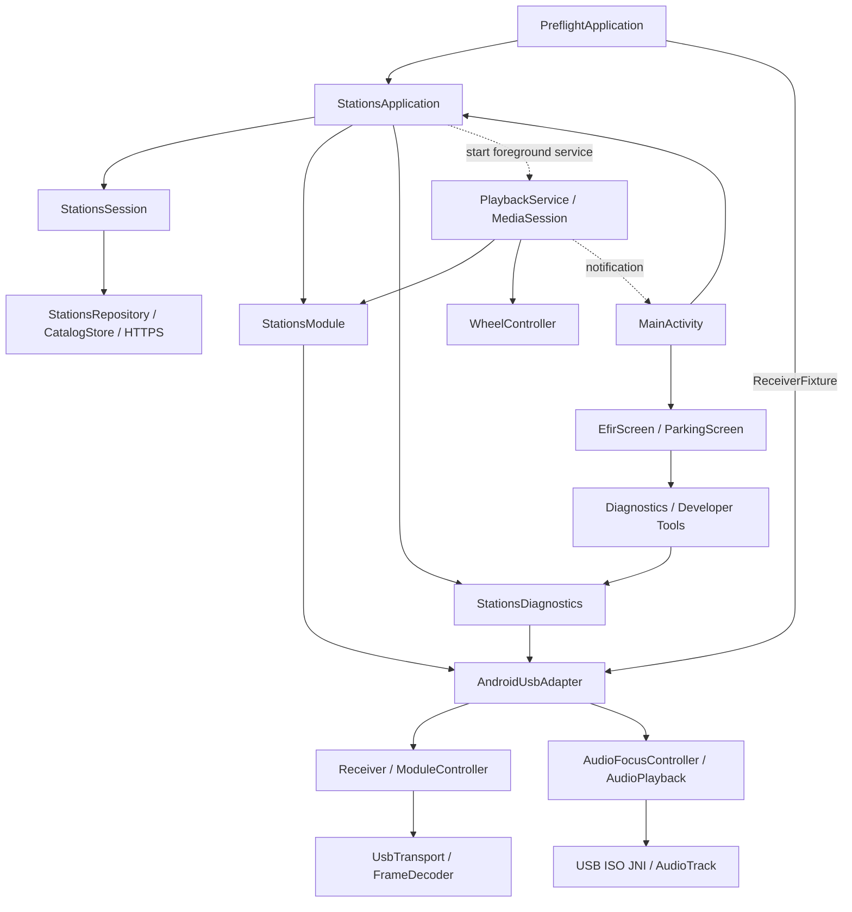
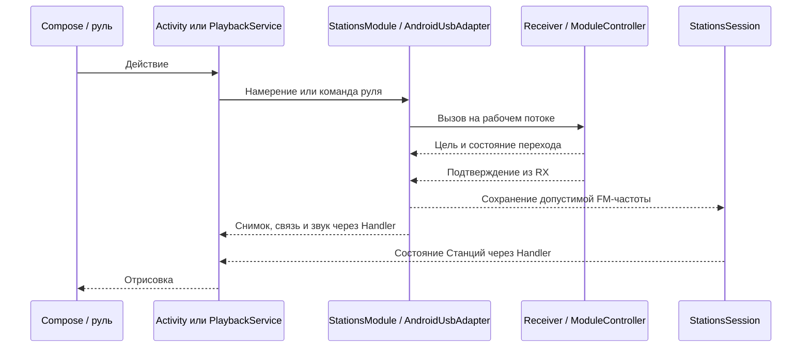

# Аудит границы UI и Core

База аудита — `31bc3eaf8afb22a33f1c299935565a9ea5f9c97b`. Это статическая проверка исходников и тестов. Она не измеряет поведение на ГУ.

Проект уже умеет отрисовать Эфир с подставным состоянием. Звук и руль уже работают через сервис с жизненным циклом, отдельным от экрана. Заменить UI независимо мешают сборка в одном модуле, общие типы, состояние Compose в объектах приложения и правила, распределённые между экраном, Activity и сервисом.

## Фактическая карта

| Участок | Реализация и поток |
| --- | --- |
| Запуск | Один Android-модуль `:app`. `StationsApplication.onCreate` создаёт сессию, управление Приёмником и Диагностику. Discovery начинается после загрузки данных. `MainActivity.onCreate` сообщает об открытии для R25. [Gradle][gradle], [Application][application], [Activity][activity] |
| Эфир | `EfirScreen` принимает `StationsScreenState`, `TransitionSnapshot`, Возможности, флаги и `EfirActions`. Включает верхнюю строку, плашки Подборки и Справочника, кнопки, шкалу `BandScale`, `Loupe`, отметки `ScaleCursor` и `SeekControl` с `PauseRing`. Оформление в `HeterodyneTheme`, `DesignTokens`, `DesignTypography`, `Appearance`. [Эфир][efir], [UI][ui] |
| Стоянка | `ParkingScreen` держит навигацию, раздел Подборок с редактором, Настройки с выбором Региона, Диагностику и `AboutScreen`. `ParkingComponents` содержит общие элементы и значок Режима разработчика. Действия идут в сессию, управление Приёмником и настройки. [Стоянка][parking], [подключение экрана][parking-wiring] |
| Состояние и действия | Классов AndroidX `ViewModel` в `app/src` нет. Роль модели экрана выполняют process-wide `StationsSession`, `StationsModule` и `StationsDiagnostics` с `mutableStateOf`. `MainActivity` связывает свойства и callbacks с Compose. [сессия][session], [управление][module], [диагностика][diag] |
| Приёмник | `Receiver` — внутренний интерфейс рабочего потока. `ReceiverProfiles` сопоставляет дескрипторы, `ReceiverSelection` сохраняет выбор без автоматической подмены. Реестр по умолчанию содержит Модуль, его реализует `ModuleController`. `AndroidUsbAdapter` владеет очередью, Android discovery, permission и transport. [Receiver][receiver], [профили][profiles], [очередь][usb] |
| Аудио | `AndroidUsbAdapter` собирает `AudioPlayback`, `AudioFocusController`, `TransitionSignal`, Android `AudioTrackSink`. Java `UsbIso` вызывает `usbiso.c`, `Frames` выравнивает аудиобайты. `PlaybackService` держит foreground notification и платформенную `MediaSession`, `WheelController` разбирает действия руля. [аудио][audio], [JNI][jni], [сервис][playback], [руль][wheel] |
| Данные | `StationsSession` владеет очередями хранения и сети. `StationsRepository` и `AtomicStationsFile` обслуживают `stations.json`, `CatalogStore` — снимок в assets и атомарное обновление. Отдельные ключи `SharedPreferences` хранят внешний вид, выбор Приёмника, Предел Поиска, Сигнал Перехода, автозапуск и Режим разработчика. [сессия][session], [данные][storage], [настройки][activity] |
| Диагностика | `StationsDiagnostics` связывает Журнал, `DiagnosticFrames`, счётчики звука, `EnvironmentProbe` и экспорт через `MediaStoreDownloads`. `DiagnosticsScreen` и `DeveloperToolsScreen` принимают сам объект диагностики. Инструменты опрашивают Журнал, кадры и счётчики из Compose. [Диагностика][diag], [инструменты][tools] |
| Preflight | Manifest заменяет Application. `PreflightApplication` проверяет эмулятор и пустой список устройств через Android `UsbManager`. `ReceiverFixture` подменяет transport, audio port и PCM. В fixture-ветке адаптер пропускает broadcast и USB discovery, но общий контроллер, `AudioTrack`, UI и сервис остаются. [preflight][preflight], [fixture][fixture], [ветка адаптера][usb] |

## Ответы на вопросы о развязке

| Вопрос | Результат |
| --- | --- |
| Можно ли работать без физического Приёмника? | Да. Штатный APK показывает отключение и даёт работать с данными. Preflight имитирует работающий Модуль. |
| Можно ли работать вообще без USB-подсистемы? | Да для отдельных composable в тестовом хосте. Штатное Application запускает discovery. Preflight проверяет Android USB service, поэтому для независимого UI нужен отдельный host. |
| Можно ли реализовать новый UI без изменения Core? | Некоторые экраны заменяемы через callbacks внутри `:app`. Полный UI требует заново связать Activity, режимы, настройки, Диагностику и конкретные модели. Сборка не ограничивает доступ к Core. |
| Может ли Core работать без Compose и Activity? | `ModuleController`, правила Станций и `WheelController` уже проверяются отдельно. PlaybackService работает без отображаемого экрана. Полное приложение использует Compose Runtime в объектах приложения и Activity для сигнала открытия, режима и Android permissions. |
| Где нужен Android? | USB API, питание и permission, аудиофокус, `AudioTrack`, Service и `MediaSession`, GNSS, Android files/assets/preferences, публичный экспорт. Правила и преобразование в UI-снимок могут использовать обычный Kotlin. Граница UI не требует сейчас переносить каждый Android вызов за новый интерфейс. |
| Какие правила находятся в UI? | Activity решает toggle звука, допуск Стоянки и момент передачи допуска в сессию. Эфир выбирает приоритет Причины выключения, подтверждённую или сохранённую частоту и имя. Настройки фильтруют пункты по виду Приёмника. Экран Диагностики ограничивает доступ к инструментам. Жест Лупы и оформление остаются ответственностью UI. |
| Кто владеет подтверждением? | `ModuleController` принимает допустимый `0x22` и публикует `confirmed`. `target` может существовать до отправки. `StationsModule.currentStation` приходит отдельным callback. `lastStation` — сохранённые данные. `TopbarStation` использует их как резерв отображения. [приём RX][rx], [резерв отображения][topbar] |
| Как обрабатываются асинхронность и ошибки? | Worker сериализует команды; Переход оставляет одну последнюю цель. Контроллер задаёт лимиты и тайм-ауты. USB permission и автозапуск сверяют поколения, Справочник закрывает загрузку и сверяет разрешение на записи. Результаты многих обычных действий теряются при вызове через `Unit`. [Переход][transition], [адаптер][usb-actions], [Справочник][catalog] |
| Как работают руль и `MediaSession`? | Сервис получает NEXT/PREVIOUS без композиции, определяет короткое и длинное нажатие, обновляет Подборку и отправляет действие. После остановки звука сервис освобождает сессию. Нажатие уведомления открывает Activity. Возврат руля на конкретном ГУ имеет отдельную приёмку. |
| Какие тесты есть? | См. карту покрытия ниже. Граница пригодности альтернативного UI пока отдельным build target не проверяется. |

## Проблемы и риски

| ID | Тип и серьёзность | Граница, свидетельство, последствие | Рекомендация |
| --- | --- | --- | --- |
| A1 | Доказано, высокая | UI и код USB доступны в одном compile classpath. Activity передаёт конкретные сессию, контроллер и диагностику, а Core использует Compose Runtime. Внешний исполнитель получает внутренние типы и wiring. [Gradle][gradle], [Activity][activity], [сессия][session], [управление][module] | Выделить Kotlin-контракт и Compose-модуль, оставить владельца сеанса в `:app`. |
| A2 | Доказано, высокая | `transition`, `currentStation`, связь, Подборка и звук публикуются отдельно. Контроллер также сохраняет внутренний `confirmed` при disconnect. Адаптер фильтрует снимок по состоянию связи, а отдельные callbacks остаются. Расхождение в отрисовке не измерялось. У независимого UI нет правила согласованного чтения, а `Unit` скрывает `TuneResult`. [снимок][rx], [callback][module-observe], [команды][usb-actions] | Один согласованный снимок, явные ожидание/подтверждение/сохранение и типизированный отказ. Сверять поколение Приёмника. |
| A3 | Доказано, высокая | Защита стоянки неоднородна. Для выбора Приёмника и публикации Справочника есть повторные guards, а отдельные методы правки и экспорта полагаются на вызов из экрана. У нового UI появится путь мимо текущего экрана. [binding][parking-wiring], [правка][edits], [экспорт][diag-export], [смена][switch] | Допуск на стороне владельца действий. Проверить его в очереди перед эффектом. |
| A4 | Долг, средняя | `WheelController` и `StationsModule.nextStation` держат разные курсоры и пути выбора. У руля дополнительный таймер. Операции уже проходят через лимит контроллера, но экран и руль могут по-разному выбрать следующую Станцию. [курсор экрана][cursor], [курсор руля][wheel], [сервис][playback] | Сохранить текущие последовательности в тестах. Общая точка действий обязательна. Решение об объединении курсоров вынести владельцу. |
| A5 | Доказано, средняя | Экран инструментов опрашивает внутренние данные и перечисляет `DiagnosticCommand` из USB-пакета. `StationsDiagnostics.diagnosticCommand` проверяет флаг и экспорт, а допуск Стоянки приходит от composable. Строка результата и `TransitionSnapshot.banner` также привязаны к русскому тексту. [инструменты][tools], [диагностика][diag-export], [снимок][transition-types] | Публиковать ограниченный снимок и закрытый список допустимых действий. UI локализует стабильные причины. |
| A6 | Долг, средняя | `Receiver` отдаёт типы из `module` и `audio`, например `Band`, `DeviceProfile`, `TuneResult`, `AudioCounters`. Прямой экспорт интерфейса заставит UI знать детали Модуля. [Receiver][receiver] | Проецировать только продуктовые состояния и действия. |
| A7 | Доказано, средняя | GNSS и событие открытия завязаны на Activity, permission и тема на Android-окружение. При замене launch Activity легко потерять R25 или сброс допуска при уходе в фон. [Activity][activity], [гистерезис][driving] | Оставить Android host с Application и Service у интегратора. UI получает состояние режима, открытие Стоянки отправляет как действие. |
| A8 | Риск, средняя | Приложение содержит профиль только Модуля. Нет реализованного RTL-SDR V4, источника SNR и декодированного RDS в этой базе. Непроверенный байт `+7` виден в Диагностике. [профили][profiles], [инструменты][tools], [R17–R18](../requirements.md), [исследование](../research/hardware-protocol-notes.md) | Профиль без Поиска проверять синтетикой. Не выводить шкалу, SNR, stereo/lock или RDS до реализации и приёмки. |
| A9 | Доказано по коду, высокая | Диагностический BAND вызывает `switchBand()`. В этом пути код допускает FM → AM, хотя whitelist разрешает только AM → FM. Этот вывод получен из исходников, аппаратной отправки не было. [вызов][diag-band], [контроллер][band-impl], [whitelist](../research/command-catalog.md) | Публичное действие ReturnToFm с проверкой текущего диапазона перед отправкой. Fake transport проверяет ноль TX в FM и до наблюдения диапазона. |

Гипотезы для проверки реализации: смешанные снимки на detach под нагрузкой, влияние проекции на задержку UI, корректность визуальных эталонов на размерах ГУ. Ни статический аудит, ни preflight не доказывают эти свойства.

### Карта покрытия

| Уровень | Что проверяется в базе |
| --- | --- |
| Контроллер | `TuneTest`, `TransitionTest`, `CommandPauseTest`, `SeekPauseHintTest`, `ReceiverTest`, `ReceiverSelectionTest`, `LaunchAutostartTest` и `AutostartGenerationTest` проверяют fake transport, подтверждение, лимиты, выбор и отмену автозапуска. |
| Данные | `ParkingSessionTest` проверяет устаревший Регион и перестановку после удаления. `CatalogSessionTest` проверяет отмену и публикацию. `SessionStorageTest`, `LaunchSessionTest` и `Schema3StorageTest` покрывают сохранение и восстановление. |
| Звук и руль | `AudioFocusTest`, `AudioPlaybackTest`, `AudioBudgetTest`, `WheelControllerTest` покрывают политику и таймеры. `Run4AudioTest` проверяет MediaSession и фокус на эмуляторе. `Run4LifecycleTest` покрывает синтетический replug, устаревшие данные и обрыв PCM. |
| UI | `EfirScreenTest`, `BandScaleTest`, `LoupeTest`, `ParkingScreenTest`, `SettingsScreenTest`, `DiagnosticsScreenTest` проверяют состояние, клики и правила представления. `VisualRegressionTest` покрывает два эталона Эфира на API 35. `Run4UiTest` проверяет размеры, данные, обновление и экспорт. |
| Preflight | `PreflightGuardTest`, `FakeReceiverTest`, `SyntheticPcmTest` и `PreflightReceiverSmokeTest` проверяют подстановку транспорта и запуск. Сами тесты перечислены с исходниками в [плане проверок](../test-plan.md). |

## Варианты и рекомендация

A — пакет `ui` и фасад внутри `:app`. B — Kotlin-модуль контракта, сменный Compose-модуль и Application Adapter внутри `:app`. Отдельный Android Sandbox использует тот же контракт. C — вариант B с немедленным переносом всего Core в чистый JVM-модуль и созданием портов для каждой Android-службы.

| Критерий | A. Пакеты | B. Модули на границе UI | C. Немедленный вынос Core |
| --- | --- | --- | --- |
| Простота и абстракции | Мало новых файлов. Границу проверяет lint или review. | Два производственных модуля на нужной границе. Один адаптер и одна подмена Sandbox. | Больше модулей, связей и адаптеров сразу. |
| Независимость людей и агентов | Один classpath и общий контекст сборки. | Сборку и тесты UI можно выполнить с JAR контракта и Sandbox. | Та же независимость UI. Дополнительная независимость нужна команде Core. |
| Совместимость и миграция | Минимальная начальная миграция. | Инкрементальная замена подключения экрана. Сохраняет APK, ключи данных и потоки. | Одновременное затрагивание USB, аудио, запуска и хранения. |
| Тестируемость | Тесты фасада возможны. Нарушение зависимости может компилироваться. | Сборка отклоняет ссылку на внутренности. Контракт проверяется с двумя реализациями. | Удобные JVM-тесты всего Core ценой большого переноса. |
| Производительность | Та же память и процесс. | Та же память и процесс. Измерить частоту проекции и исключить её из аудиопотока. | Теоретически та же. Перенос рабочих очередей повышает цену проверки. |
| Безопасность на ходу | Проверки придётся централизовать при любом варианте. | Независимый UI получает допуск и не владеет worker или устройством. | Больше точек для регрессии при первичном переносе. |
| Новые Приёмники | Можно добавить, если фасад скрывает их детали. | Возможности и поведение расширяются через контракт после проверки. | Порты легче заменить, но пока существует один реальный адаптер. |

Рекомендация — B. Производственный Core работает без Compose и владельца экрана по мере перевода объектов состояния на Kotlin. Android-взаимодействие остаётся у host. Широкую замену потоков, хранилищ, `Receiver` и JNI можно оценить отдельным решением, когда появится второй реальный потребитель этой границы. [ADR](../adr/0010-ui-core-separation.md), [миграция](../plans/ui-core-separation.md).

Открытые вопросы владельцу: утвердить границу сборки, правила режима и фоновых действий, сохранение текущей политики фокуса, совместный курсор Эфира и руля, формат передачи UI SDK. Отдельные решения по тематике, RTL-SDR и приёмке остаются в существующих задачах. [ADR](../adr/0010-ui-core-separation.md).

При выборе границы учтены первичные источники. Kotlin ограничивает `internal` единицей компиляции. Android описывает подключение разных реализаций через модуль интерфейсов. Для Heterodyne FM из этого следует проверяемая граница при сборке, если `:ui-compose` и `:ui-sandbox` не зависят от `:app`. Вывод о конкретных модулях сделан по этому аудиту. [Kotlin Visibility](https://kotlinlang.org/docs/visibility-modifiers.html#modules), [Android Modularization](https://developer.android.com/topic/modularization/patterns#dependency-inversion), [Gradle Java Library](https://docs.gradle.org/current/userguide/java_library_plugin.html#sec:java_library_separation).

Сбор состояния Compose с учётом жизненного цикла относится к UI. Платформенная MediaSession регистрирует callback независимо от композиции. Это согласуется с текущим сервисом Heterodyne FM. Поддержку руля на ГУ проверяет отдельный сценарий. [Compose State](https://developer.android.com/develop/ui/compose/state#other-supported-types-of-state), [Android MediaSession](https://developer.android.com/reference/android/media/session/MediaSession).

## Метод и связанные работы

`graphify update .` и запросы по связям выполнены с кодом 0. Граф содержал 3952 узла и 8219 связей. Анализатор частично разобрал `AudioPlayback.kt`, `ModuleController.kt`, `UsbTransport.kt`, `AndroidEnvironmentProbe.kt` и `AndroidUsbAdapter.kt`. Общий запрос разрешил `MainActivity` в исследовательский Java-класс. Связи проверены чтением Kotlin, Java, C и поиском `rg`. Отсутствие узла не использовалось как доказательство отсутствия кода.

На момент аудита открытых PR не было. Issues [#238](https://github.com/krasotinpa/heterodyne-fm/issues/238), [#170](https://github.com/krasotinpa/heterodyne-fm/issues/170), [#312](https://github.com/krasotinpa/heterodyne-fm/issues/312) и [#313](https://github.com/krasotinpa/heterodyne-fm/issues/313) касаются существующего UI. Приёмка руля, звука и перехода остаётся в [#89](https://github.com/krasotinpa/heterodyne-fm/issues/89), [#197](https://github.com/krasotinpa/heterodyne-fm/issues/197) и [#208](https://github.com/krasotinpa/heterodyne-fm/issues/208). RTL-SDR и поля сигнала ведутся в [#150](https://github.com/krasotinpa/heterodyne-fm/issues/150), [#154](https://github.com/krasotinpa/heterodyne-fm/issues/154), [#159](https://github.com/krasotinpa/heterodyne-fm/issues/159)–[#161](https://github.com/krasotinpa/heterodyne-fm/issues/161) и [#165](https://github.com/krasotinpa/heterodyne-fm/issues/165). Отмена Поиска и импорт данных остаются в [#187](https://github.com/krasotinpa/heterodyne-fm/issues/187) и [#277](https://github.com/krasotinpa/heterodyne-fm/issues/277).

[gradle]: ../../settings.gradle.kts
[application]: ../../app/src/main/kotlin/fm/heterodyne/app/StationsApplication.kt#L18-L27
[activity]: ../../app/src/main/kotlin/fm/heterodyne/app/MainActivity.kt#L14-L119
[efir]: ../../app/src/main/kotlin/fm/heterodyne/app/ui/EfirScreen.kt#L83-L165
[ui]: ../../app/src/main/kotlin/fm/heterodyne/app/ui
[parking]: ../../app/src/main/kotlin/fm/heterodyne/app/ui/ParkingScreen.kt#L57-L395
[parking-wiring]: ../../app/src/main/kotlin/fm/heterodyne/app/MainActivity.kt#L129-L162
[session]: ../../app/src/main/kotlin/fm/heterodyne/app/StationsSession.kt#L23-L68
[module]: ../../app/src/main/kotlin/fm/heterodyne/app/StationsModule.kt#L19-L77
[diag]: ../../app/src/main/kotlin/fm/heterodyne/app/StationsDiagnostics.kt#L9-L77
[receiver]: ../../app/src/main/kotlin/fm/heterodyne/app/receiver/Receiver.kt#L18-L57
[profiles]: ../../app/src/main/kotlin/fm/heterodyne/app/receiver/ReceiverProfiles.kt#L20-L37
[usb]: ../../app/src/main/kotlin/fm/heterodyne/app/usb/AndroidUsbAdapter.kt#L275-L299
[audio]: ../../app/src/main/kotlin/fm/heterodyne/app/usb/AndroidUsbAdapter.kt#L212-L244
[jni]: ../../app/src/main/jni/usbiso.c#L37-L91
[playback]: ../../app/src/main/kotlin/fm/heterodyne/app/audio/PlaybackService.kt#L19-L103
[wheel]: ../../app/src/main/kotlin/fm/heterodyne/app/audio/WheelController.kt#L11-L81
[storage]: ../../app/src/main/kotlin/fm/heterodyne/app/stations/StationsStorage.kt#L143
[tools]: ../../app/src/main/kotlin/fm/heterodyne/app/ui/DeveloperToolsScreen.kt#L13-L46
[preflight]: ../../app/src/preflight/kotlin/fm/heterodyne/app/preflight/PreflightApplication.kt#L10-L45
[fixture]: ../../app/src/main/kotlin/fm/heterodyne/app/receiver/ReceiverFixture.kt
[rx]: ../../app/src/main/kotlin/fm/heterodyne/app/module/ModuleController.kt#L158-L197
[topbar]: ../../app/src/main/kotlin/fm/heterodyne/app/ui/TopbarStation.kt#L7-L9
[transition]: ../../app/src/main/kotlin/fm/heterodyne/app/module/ModuleController.kt#L131-L332
[transition-types]: ../../app/src/main/kotlin/fm/heterodyne/app/module/ModuleController.kt#L11-L36
[usb-actions]: ../../app/src/main/kotlin/fm/heterodyne/app/usb/AndroidUsbAdapter.kt#L296-L335
[catalog]: ../../app/src/main/kotlin/fm/heterodyne/app/StationsSession.kt#L70-L137
[edits]: ../../app/src/main/kotlin/fm/heterodyne/app/StationsSession.kt#L158-L217
[diag-export]: ../../app/src/main/kotlin/fm/heterodyne/app/StationsDiagnostics.kt#L77-L93
[switch]: ../../app/src/main/kotlin/fm/heterodyne/app/usb/AndroidUsbAdapter.kt#L358-L373
[cursor]: ../../app/src/main/kotlin/fm/heterodyne/app/StationsModule.kt#L69-L100
[driving]: ../../app/src/main/kotlin/fm/heterodyne/app/ui/DrivingState.kt#L3-L56
[module-observe]: ../../app/src/main/kotlin/fm/heterodyne/app/StationsModule.kt#L119-L154
[diag-band]: ../../app/src/main/kotlin/fm/heterodyne/app/usb/AndroidUsbAdapter.kt#L59-L76
[band-impl]: ../../app/src/main/kotlin/fm/heterodyne/app/module/ModuleController.kt#L264-L273
